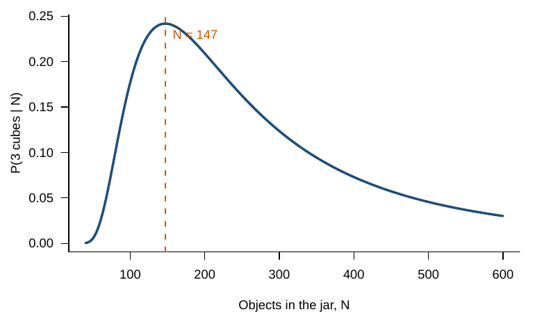

# The jar activity {#jar}

## Materials

- A clear jar with $N = 126$ objects. Count the objects once in advance and keep the number secret.
- 21 blue plastic cubes used as tags.
- A tray or box with a red circle taped on the bottom. The circle is the sample.
- A whiteboard to record $M$, $n$, and $k$.

```{r jar-photo, echo = FALSE, out.width = "45%", fig.show = "hold", fig.cap = "The jar (left) and a drawing of the jar with blue cubes mixed in (right)."}
knitr::include_graphics(c("images/jar.jpg", "images/jar-drawing-cubes.jpg"))
```

## Protocol

1. **First toss.** Spread the whole jar across the tray.
2. **Tag.** Swap every pebble inside the circle for a blue cube. The number of swaps is $M$. Swapping keeps the total $N$ unchanged.
3. **Mix.** Pour everything back into the jar and mix well.
4. **Second toss.** Toss again. Inside the circle, count all objects ($n$) and the cubes among them ($k$).
5. **Estimate** $N$ (Section \@ref(estimator)).
6. **Repeat** steps 3 to 5 and record each run.

```{r mat-photos, echo = FALSE, out.width = "32%", fig.show = "hold", fig.cap = "First toss, swap, and second toss."}
knitr::include_graphics(c("images/mat-1-toss.jpg", "images/mat-2-swap.jpg", "images/mat-3-retoss.jpg"))
```

## The jar is a binomial experiment

| Jar | Binomial |
|---|---|
| Cubes swapped in | $M$ |
| Objects in the circle on the second toss | $n$ tries |
| Cubes in the circle | successes, $X$ |
| Share of the jar that is cubes | $p = M/N$ |
| Mixing the jar | independent tries |
| Cubes and pebbles equally likely to land in the circle | same $p$ on every try |

## The estimator {#estimator}

If the jar is well mixed, the share of cubes in the circle should be close to the share of cubes in the jar: $k/n \approx M/N$. The binomial gives the same answer. The expected number of cubes in the circle is $E(X) = nM/N$. Setting the expected count equal to the observed count $k$ and solving for $N$ gives the Lincoln-Petersen estimator:
$$
\hat N = \frac{Mn}{k}.
$$

**Worked example.** In run 3 at home, $M = 21$, $n = 21$, and $k = 3$. Cubes are one seventh of the circle, so cubes should be about one seventh of the jar: $\hat N = 21 \times 21 / 3 = 147$. Of all values of $N$, 147 is also the value that makes 3 cubes most likely.

```{r likelihood, echo = FALSE, out.width = "70%", fig.cap = "Probability of seeing 3 cubes among 21 objects, as a function of the number of objects in the jar."}

```

The Lincoln-Petersen estimator is undefined when $k = 0$. The Chapman estimator adds one to each count and subtracts one at the end:
$$
\hat N_C = \frac{(M + 1)(n + 1)}{k + 1} - 1.
$$
For run 3, the Chapman estimator gives 120.
