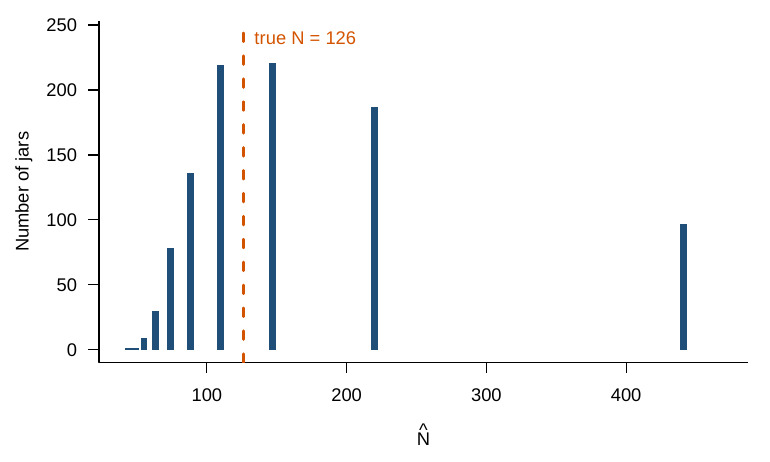
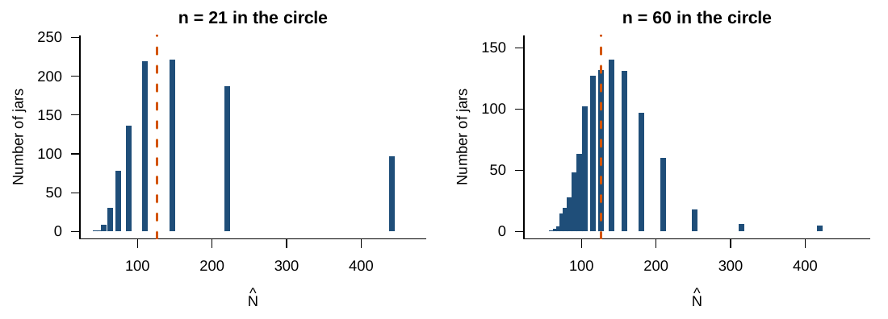

# Simulating the jar {#simulating}

The computer version of the jar follows the binomial exactly: each object in the circle is a cube with probability $M/N$. All simulations use 1,000 repetitions and `set.seed(2026)`.

```{r jar-sim, eval = FALSE}
set.seed(2026)
N <- 126   # true total (unknown in practice)
M <- 21    # cubes swapped in
n <- 21    # objects in the circle on the second toss

k1 <- rbinom(1, size = n, prob = M / N)   # one toss
M * n / k1                                # one estimate of N

R <- 1000
k <- rbinom(R, size = n, prob = M / N)
N_hat <- ifelse(k > 0, M * n / k, NA)
summary(N_hat)
quantile(N_hat, c(0.05, 0.95), na.rm = TRUE)   # middle 90% of the estimates
mean(k == 0)                                   # share of jars with no cubes in the circle
```

```{r sim-lake, echo = FALSE, out.width = "75%", fig.cap = "Estimates from 1,000 simulated jars with N = 126, M = 21, and n = 21."}

```

The estimates have a median of 147, and the middle 90% runs from 74 to 441. The distribution is skewed right: tosses with few cubes in the circle divide by a small number and give very large estimates. The distribution also has gaps, because $\hat N = 441/k$ takes only a few values. About 2% of jars have no cube in the circle.

## What does a bigger second toss buy?

```{r jar-n, eval = FALSE}
sim_jar <- function(n, R = 1000) {
  k <- rbinom(R, size = n, prob = M / N)
  ifelse(k > 0, M * n / k, NA)
}
est_21 <- N_hat
est_60 <- sim_jar(60)
rbind("n = 21" = quantile(est_21, c(0.05, 0.95), na.rm = TRUE),
      "n = 60" = quantile(est_60, c(0.05, 0.95), na.rm = TRUE))
```

```{r sim-n, echo = FALSE, out.width = "95%", fig.cap = "A second toss of 60 objects instead of 21."}

```

With $n = 60$, the median is 126, the middle 90% runs from 84 to 210, and no jar has $k = 0$. A larger sample narrows the spread of the estimates around the true total.
