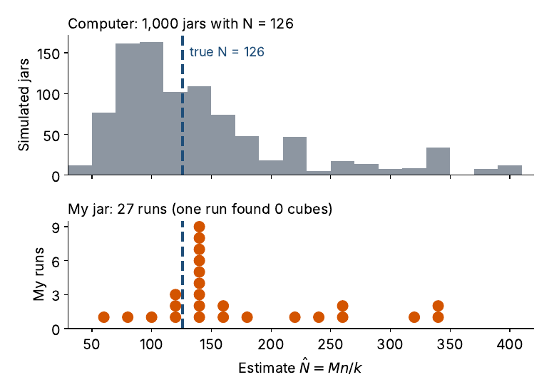

# My jar at home {#home}

I ran the activity 28 times with the real jar ($N = 126$, $M = 21$) and recorded the pebbles and cubes inside the circle on each second toss. The data are in `jar-runs.csv`. A video of the tosses follows; the same video is on YouTube at <https://youtu.be/LEBHiUieLOI>.

```{=html}
<div class="video"><iframe src="https://www.youtube-nocookie.com/embed/LEBHiUieLOI" title="Video of the pebble-jar tosses" loading="lazy" allow="accelerometer; clipboard-write; encrypted-media; picture-in-picture" allowfullscreen></iframe></div>
```

```{r home-data, eval = FALSE}
pebbles <- c(20, 6, 18, 16, 15, 12, 15, 18, 11, 21, 11, 16, 13, 17,
             13, 23, 16, 12, 15, 14, 15, 16, 16, 24, 17, 18, 8, 17)
cubes   <- c(2, 3, 3, 4, 1, 2, 3, 3, 2, 3, 1, 0, 2, 3,
             3, 2, 3, 4, 3, 1, 1, 3, 3, 4, 3, 2, 1, 3)
n_home <- pebbles + cubes
N_home <- ifelse(cubes > 0, 21 * n_home / cubes, NA)
median(N_home, na.rm = TRUE)                  # 147
21 * sum(n_home) / sum(cubes)                 # pooled estimate, 155
sum(cubes) / sum(n_home)                      # 0.14, against 21/126 = 0.17 in the jar
median((21 + 1) * (n_home + 1) / (cubes + 1) - 1)   # Chapman, 115
```

## What the real jar showed

The estimates ranged from 63 to 336, with a median of 147 and a pooled estimate of 155. One run found no cubes, so the Lincoln-Petersen estimator gave no answer for that run; the Chapman estimator still did, with a median of 115 across all 28 runs.

The estimates ran high. On average, 2.4 cubes landed in the circle, while the binomial expects about 3 given the observed values of $n$. Cubes were 14% of the objects in the circle but 17% of the jar. The cubes were less likely than the pebbles to land in the circle, so $k$ ran small and $\hat N$ ran large. The "same $p$" condition failed in the real jar.

```{r home-vs-sim, echo = FALSE, out.width = "75%", fig.cap = "Top: 1,000 simulated jars that follow the binomial. Bottom: 27 home runs with at least one cube."}

```

<div class="callout">
**The gap is the lesson.** The computer follows the binomial and centers near the truth (median 116). The real jar does not, because a lighter, flatter cube slides differently from a pebble. Ask students why the real estimates might run high before showing the answer.
</div>
