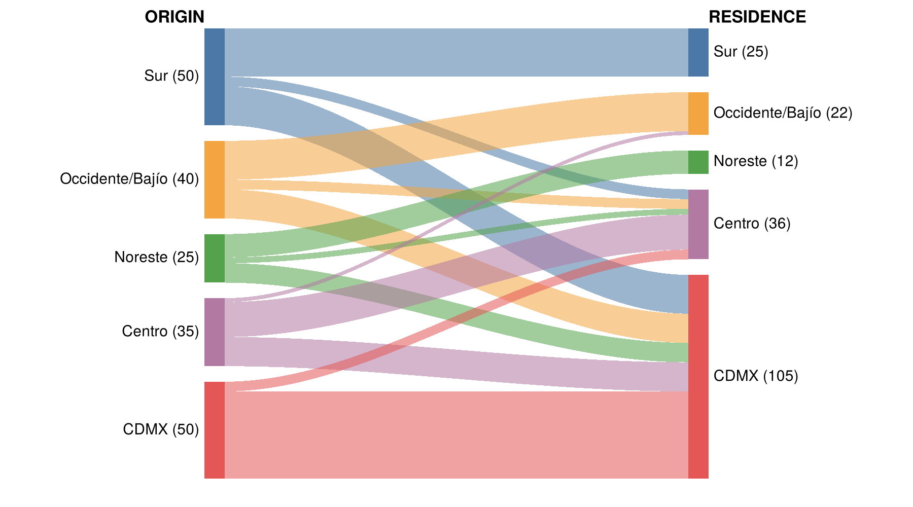
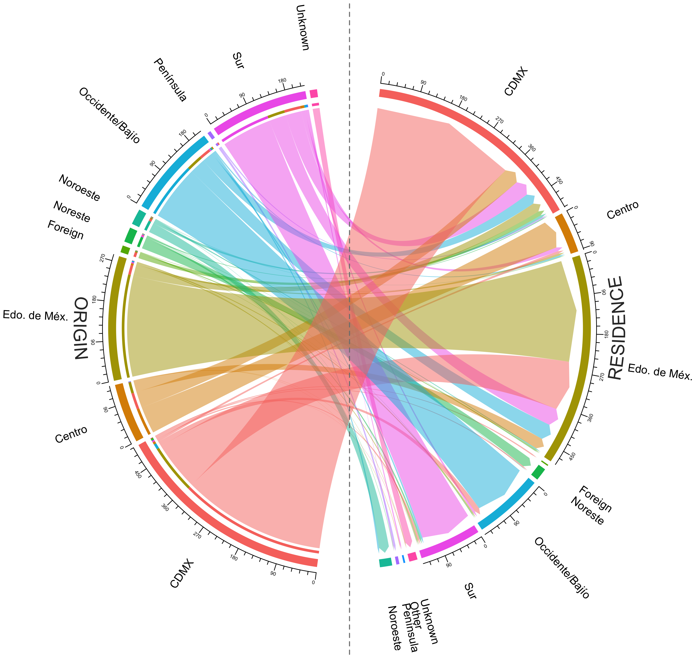

# From pebbles to people {#clinics}

HD is a rare inherited brain disorder; a child of a parent with HD has a 50% chance of inheriting the gene. The largest known HD family lives along Lake Maracaibo in Venezuela, and blood samples from those families helped locate the HD gene in 1983 and identify the gene in 1993. Across Latin America, many people with HD are never diagnosed or never see a specialist, and many countries have no complete registry. A health ministry needs the count to plan neurologists, genetic counselors, and long-term care.

## Two clinics, two lists

Consider two clinics in one region (illustrative numbers). Clinic A has diagnosed 60 people with HD, clinic B has diagnosed 45, and 15 people appear on both lists. The two lists play the roles of the jar:

| Jar | Clinics |
|---|---|
| Cubes swapped in, $M$ | Clinic A's list, 60 |
| Objects in the circle, $n$ | Clinic B's list, 45 |
| Cubes in the circle, $k$ | People on both lists, 15 |

The same formula gives $\hat N = 60 \times 45 / 15 = 180$. The Chapman estimator gives about 174.

## When the estimate goes wrong

The estimate is only as good as the binomial conditions. The simulation below creates a region with exactly 180 people with HD, 1,000 times, under four scenarios.

```{r clinics, eval = FALSE}
sim_clinics <- function(scenario, N = 180, R = 1000) {
  est <- numeric(R)
  for (r in 1:R) {
    if (scenario == "Independent lists") {
      a <- runif(N) < 1/3
      b <- runif(N) < 1/4
    } else if (scenario == "Referral") {
      a <- runif(N) < 1/3
      b <- ifelse(a, runif(N) < 0.5, runif(N) < 0.167)
    } else if (scenario == "Hard-to-reach group") {
      hard <- seq_len(N) <= 60
      a <- runif(N) < ifelse(hard, 0.10, 0.43)
      b <- runif(N) < ifelse(hard, 0.10, 0.33)
    } else if (scenario == "Separate catchments") {
      near_b <- seq_len(N) <= N / 2
      a <- runif(N) < ifelse(near_b, 0.10, 0.55)
      b <- runif(N) < ifelse(near_b, 0.50, 0.10)
    }
    k <- sum(a & b)
    est[r] <- if (k > 0) sum(a) * sum(b) / k else NA
  }
  est
}
set.seed(2026)
scenarios <- c("Independent lists", "Referral", "Hard-to-reach group", "Separate catchments")
res <- lapply(scenarios, sim_clinics); names(res) <- scenarios
sapply(res, median, na.rm = TRUE)
```

| Scenario | Setup | Median $\hat N$ | Direction |
|---|---|---|---|
| Independent lists | $P(A) = 1/3$, $P(B) = 1/4$ | 181 | Centered on the truth |
| Referral | $P(A) = 1/3$; $P(B \mid A) = 0.5$, $P(B \mid \text{not } A) = 0.167$ | 100 | Too small every time |
| Hard-to-reach group | 60 people with a 10% chance at each clinic; 120 with 43% (A) and 33% (B) | 150 | Too small in 86% of runs |
| Separate catchments | 90 near B ($P(A) = 0.10$, $P(B) = 0.50$); 90 near A ($P(A) = 0.55$, $P(B) = 0.10$) | 340 | Too large every time |

```{r clinic-figs, echo = FALSE, out.width = "32%", fig.show = "hold", fig.cap = "Referral, hard-to-reach group, and separate catchments (blue) against independent lists (gray). The dashed line marks the true 180."}
knitr::include_graphics(c("images/sim_referral.png", "images/sim_hard.png", "images/sim_catch.png"))
```

Referral and a hard-to-reach group make the lists overlap too much, so $k$ is too large and $\hat N$ falls short. A hard-to-reach group is the pebble that never lands in the circle. Separate catchments make the lists overlap too little, so $\hat N$ overshoots. Ask students to predict the direction of each error before showing the histogram.

## Who is hard to reach? HD in Mexico

A toy example shows how to read a flow figure. The table lists 200 invented people in five regions. Each row is a region of origin, each column is a region of residence, and the diagonal counts people who still live where they started.

| Origin / Residence | Sur | Occidente/Bajío | Noreste | Centro | CDMX | Total |
|---|---|---|---|---|---|---|
| Sur | 25 | 0 | 0 | 5 | 20 | 50 |
| Occidente/Bajío | 0 | 20 | 0 | 5 | 15 | 40 |
| Noreste | 0 | 0 | 12 | 3 | 10 | 25 |
| Centro | 0 | 2 | 0 | 18 | 15 | 35 |
| CDMX | 0 | 0 | 0 | 5 | 45 | 50 |
| Total | 25 | 22 | 12 | 36 | 105 | 200 |

The code below draws the table as a flow figure in base R. Each bar is a region: the left bars are sized by origin and the right bars by residence. Each band joins one origin to one residence, and the width of the band is the number of people.

```{r toy-flow, eval = FALSE}
par(mar = c(0.5, 0.5, 0.5, 0.5))
regions <- c("Sur", "Occidente/Bajío", "Noreste", "Centro", "CDMX")
flow <- matrix(c(25,  0,  0,  5, 20,
                  0, 20,  0,  5, 15,
                  0,  0, 12,  3, 10,
                  0,  2,  0, 18, 15,
                  0,  0,  0,  5, 45),
               nrow = 5, byrow = TRUE,
               dimnames = list(origin = regions, residence = regions))
cols <- c("#4C78A8", "#F2A541", "#54A24B", "#B279A2", "#E45756")

gap <- 8
bar_pos <- function(tot) {
  top <- c(0, head(cumsum(tot + gap), -1))
  cbind(top = top, bottom = top + tot)
}
L <- bar_pos(rowSums(flow))
R <- bar_pos(colSums(flow))
ymax <- max(L[5, "bottom"], R[5, "bottom"])

plot(NA, xlim = c(-0.32, 1.32), ylim = c(ymax, 0), axes = FALSE, xlab = "", ylab = "")
x <- seq(0.04, 0.96, length.out = 60)
s <- 3 * ((x - 0.04) / 0.92)^2 - 2 * ((x - 0.04) / 0.92)^3   # smooth S-curve
left_used <- L[, "top"]
right_used <- R[, "top"]
for (i in 1:5) for (j in 1:5) if (flow[i, j] > 0) {
  l0 <- left_used[i];  left_used[i]  <- l0 + flow[i, j]
  r0 <- right_used[j]; right_used[j] <- r0 + flow[i, j]
  top <- l0 + (r0 - l0) * s
  bot <- (l0 + flow[i, j]) + (r0 - l0) * s
  polygon(c(x, rev(x)), c(top, rev(bot)), col = adjustcolor(cols[i], 0.55), border = NA)
}
rect(0, L[, "top"], 0.04, L[, "bottom"], col = cols, border = NA)
rect(0.96, R[, "top"], 1, R[, "bottom"], col = cols, border = NA)
text(-0.01, rowMeans(L), paste0(regions, " (", rowSums(flow), ")"), adj = 1, cex = 0.9)
text(1.01, rowMeans(R), paste0(regions, " (", colSums(flow), ")"), adj = 0, cex = 0.9)
text(0, -6, "ORIGIN", adj = 1, font = 2)
text(1, -6, "RESIDENCE", adj = 0, font = 2)
```

```{r toy-migration, echo = FALSE, out.width = "80%", fig.cap = "Toy example with invented counts: where 200 people were born (left) and where they live now (right). Band width is the number of people."}

```

In the toy data, CDMX holds 50 of the 200 people by origin and 105 by residence, while Sur, Occidente/Bajío, and Noreste each lose about half of their people. The real cohort at Mexico's national referral center has the same shape with more regions.

```{r migration, echo = FALSE, out.width = "80%", fig.cap = "Where people with HD in a 30-year cohort at Mexico's national referral center come from (left) and where they live now (right)."}

```

Most of the bands bend toward Mexico City and Estado de México. Moving to Mexico City takes money; low-income families stay in their region, and some never reach any clinic. Those families form the hard-to-reach group, so a two-list estimate comes out too small. An undercount means fewer neurologists and counselors for the people already left out.
